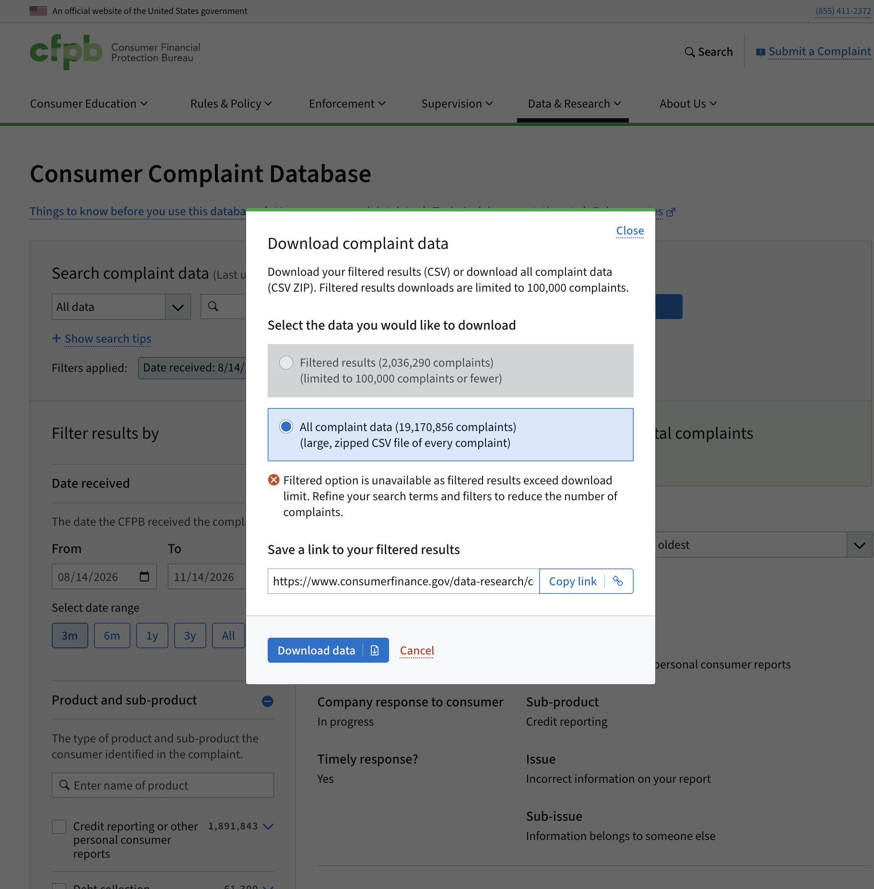

# Product features

Consumer Complaints platform, built hands-on and step by step. This file lists **what the product does**.
How it is built is in [ARCHITECTURE.md](../Middleware/ConsumerComplaintsHandsOn/ARCHITECTURE.md) and the
detailed decisions are in [DESIGN.md](../Middleware/ConsumerComplaintsHandsOn/DESIGN.md).

Status legend: **[Done]** exists in the repo, **[Planned]** decided but not built, **[Open]** not decided yet.

---

## 1. Purpose

Load the public CFPB Consumer Complaint Database into a local or cloud MongoDB through an admin portal, and later
build an intelligence app on top of it. Everything is run from the admin portal; the heavy work (download, ingest)
is done asynchronously by Apache Airflow.

## 2. Applications

| App | What it is | Status |
|---|---|---|
| `consumer-complaints-admin` | Angular admin portal. Imports datasets, ingests them into the database, shows status. | [Planned] |
| Middleware API | FastAPI service (`Middleware/ConsumerComplaintsHandsOn`). The only thing the portal talks to. | [Planned] (folder skeleton [Done]) |
| Apache Airflow | Runs the download and ingest jobs asynchronously. | [Done] locally in Docker, DAGs [Planned] |
| `consumer-complaints-Intellect` | The intelligence app that works over the complaint data (RAG / agentic). | [Open] scope not defined yet |

## 3. The data

- **Source:** the CFPB Consumer Complaint Database, free to download from the government website.
  Field reference: <https://cfpb.github.io/api/ccdb/fields.html>.
- **Fields (15):** Date received, Product, Sub-product, Issue, Sub-issue, Company public response, Company, State,
  ZIP code, Tags, Submitted via, Date sent to company, Company response to consumer, Timely response?, Complaint ID.
- **No free-text complaint narrative.** The database is structured records only.
- **Size (as of 14 Nov 2026):** 19,170,856 complaints in total; 2,036,290 in the last 3 months (8/14/2026 to 11/14/2026).
  About 93% of the last 3 months is one product, "Credit reporting or other personal consumer reports".
- **Download limits found on the CFPB site** (see the screenshots in `Docs/Design/`):
  - The filtered CSV download is **limited to 100,000 complaints**, so the 3-month window (2.0M) cannot be downloaded
    with a filter. The site disables that option.
  - The only complete download is **"All complaint data"**, one large zipped CSV (about 350 MB compressed).
  - In the part of that file I sampled, rows are **not sorted by date**, so a 3-month slice means reading the whole file
    and filtering by `Date received`.
- **The dataset is never committed to this repository.** It is fetched from a configured location (feature F3).

## 4. Features

### F1. Admin portal navigation [Planned]
- Top-level menu **DataSets**.
- Left navigation under it: **Imports** and **DB Ingest**, side by side.
- Each of the two screens shows **two accordions**: **3 months dataset** and **All dataset**.
- Later: more datasets are just more accordions / rows (for example "6 months").

### F2. Imports: bring the dataset in [Planned]
- Per accordion, show whether that dataset is downloaded or not, when, and if it failed, why. Status comes from the
  database, not from guessing.
- A button starts the download. It returns immediately; the real work runs in Airflow.
- **One API endpoint starts any kind of download.** It takes a `usecase`.
- The **3 months** dataset is the **All** file filtered to the last 3 months, because the site cannot export 3 months.
- The same flow works locally (3 months, small) and in the cloud (All).

### F3. Configurable source location (no data in the repo) [Planned]
The download reads from a **configured location type and path**. Supported types:

| Location type | Example of what you configure |
|---|---|
| Local path | a file or folder on the machine running the job |
| GitHub repo URL / path | a URL to a file in a repository |
| Google Drive | a Drive file or folder |
| AWS S3 | `s3://bucket/path` |
| Azure Blob Storage | container and blob path |
| GCP Cloud Storage | `gs://bucket/path` |
| Plain HTTP(S) URL | for example the CFPB file itself (not on the original list; **[Open]** whether to include) |

- Adding a new location type must not change the rest of the system.
- Credentials never live in the repo.
- Where the chosen location and credentials are stored is **[Open]**.

### F4. DB Ingest: load the data into MongoDB [Planned]
- A second Airflow job reads the downloaded data and writes it into MongoDB **in batches**.
- Re-running is safe: records are keyed by Complaint ID, so a retry never creates duplicates.
- Has its own screen (**DB Ingest**) with the same two accordions and its own status.
- The Ingest button is only usable once that dataset's download has completed.
- Ingest speed: start with plain Python batch writes; PySpark only if measurements say it is needed. **[Open]**

### F5. Status tracking and history [Planned]
- A common log, `data_ingest_log`, records every attempt (history) with a `purpose`.
- A table, `system_datasets`, holds the current state per dataset, which the accordions read.
- Airflow reports progress by calling the API (a `started` update and a `completed` update); it never writes to SQLite itself.
- Allowed status changes are enforced by the API, so duplicate or out-of-order callbacks are harmless.

### F6. Two environments, one codebase [Planned]
- **Local (laptop):** the 3 months dataset, everything in Docker.
- **Cloud (AWS, Azure or GCP):** the All dataset.
- Differences are configuration, not code.

### F7. Data stores [Planned]
- **MongoDB** holds the actual complaint data. [Done] a local container is configured.
- **SQLite** holds operational data only: user management, execution logs, `system_datasets`, `data_ingest_log`.
  It must be replaceable (Postgres or another database) with the fewest code changes.
- Three schemas: **`consumer_comp_db`** (consumer complaints area), **`consumer_compl_intellect_db`** (Intellect app) and
  **`consumer_comp_users_db`** (users). [Done] created by the first migration.

### F8. Database schema versioning [Done locally; cloud workflow Planned]
- Alembic migrations create and evolve the operational database.
- Locally, the start script runs the migrations first and then starts the API.
- Later, a manually triggered GitHub Actions workflow runs migrations against cloud databases (AWS RDS, Azure, GCP).

### F9. API contract [Planned]
- One OpenAPI (Swagger) specification for the whole hands-on project.

### F10. Developer experience [Done]
- One command starts, stops or checks all local containers:
  `npm run local:containers:all:start`, `local:containers:all:stop`, `local:containers:all:status`.
- Python project managed with `uv`.

### F11. Users and execution logs [Planned]
- User management and execution logs live in SQLite (details to be defined).

### F12. Intelligence app [Open]
- `consumer-complaints-Intellect`: scope not defined. An early, unreviewed RAG draft is kept for reference on the branch
  `backups/Cursor_Initial_Impl`; it is not part of `main`.

## 5. Delivery status

| Item | Status |
|---|---|
| Local Apache Airflow 3.4.0 in Docker (`CICD/Local/airflow`) | Done |
| Local MongoDB 8.0 in Docker (`CICD/Local/mongodb`) | Done (configured; start with the npm command) |
| Start / stop / status scripts and npm commands | Done |
| `uv` Python project and layered folder skeleton | Done (folders only, no logic) |
| Data ingest log: API, facade and tasks, DAO, DTOs, tests (create, get, list, update, delete) | Done |
| Three schemas and the first Alembic migration (`data_ingest_log`); local start script migrates, then starts the API | Done |
| `system_datasets`, start-download and status-callback endpoints, source locations | Planned: next |
| Airflow download and ingest DAGs | Planned |
| Admin portal (Angular) | Planned |
| Cloud deployment and manual migration workflow | Planned |

## 6. Open questions

1. Where are the chosen source location and its credentials stored (database, config file, Airflow connection)?
2. Does the Airflow download job reuse the Middleware's Python code, or carry its own copy of the download code?
3. Where does the downloaded file land between download and ingest (local folder now, object storage in the cloud)?
4. Should the plain HTTP(S) location type be supported?
5. Should the log record the absolute date range a 3-month dataset covered, and should a new download reset its ingest status?
6. Should the accordions poll for status while something is running, or only refresh on a button?
7. One row per dataset and stage in `system_datasets`, JSON, or independent columns? (one row per dataset and stage is proposed)
8. Does Intellect share the operational database?
9. What does "Airflow menu bar" in the portal mean (a link to the Airflow UI, or a screen of its own)?
