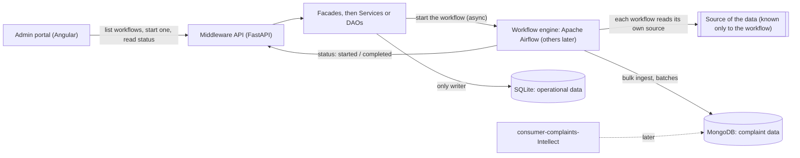
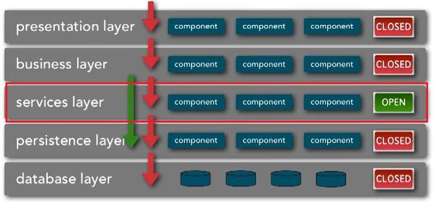
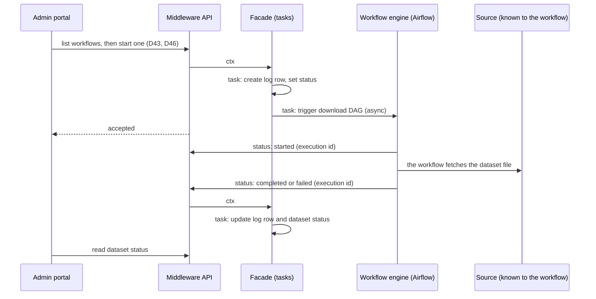

# Architecture

How the system is put together. What it does is in [PRODUCT_FEATURES.md](../../docs/PRODUCT_FEATURES.md); the detailed rules
and open decisions are in [DESIGN.md](DESIGN.md).

Status: the local containers and scripts exist, and the first vertical slice is built and tested: the **data ingest log**
(API -> facade -> tasks -> DAO -> SQLite, with an Alembic migration). Everything else is still to build.

## 1. System context



Two write rules that everything follows:

1. **SQLite is written only by the API.** Airflow may read it (D51) but never writes it; it reports progress by calling the API.
2. **MongoDB (the bulk complaint data) is written only by the Airflow ingest job**, directly, in batches.
   Pushing millions of records through the API layers would be slow and pointless.

## 2. Layered architecture (Neal Ford: closed layers, one open layer)



A request passes through each layer in turn. A **closed** layer may not be skipped. The **services** layer is the
**open** layer: a facade may call a DAO directly, or call a service.

| Layer | Folder (`app/`) | Responsibility |
|---|---|---|
| Presentation | `api` | FastAPI routes. Turns HTTP into a `ctx`, calls a facade interface, turns the result back into HTTP. |
| Business | `core/facades` | Holds an ordered list of tasks and loops over them. **No business logic of its own.** |
| Services (open) | `core/services` | Reusable logic (for example: start a workflow in its engine). |
| Persistence | `core/dao` | One DAO per table or collection. All database access lives here. |
| Database | SQLite, MongoDB | Stores. |
| Shared | `core/common` (`dtos`) | Req / Resp / Ctx types used by every layer. |

```
api  ->  IFacade  ->  [ task 1, task 2, ... ]  ->  IService  or  IDao
```

## 3. Folder layout

```
Middleware/ConsumerComplaintsHandsOn/
  app/
    api/                      endpoint classes (routers/), request and response bodies (models/), objects_factory.py
    core/
      common/                 config (schema names), return_codes, constants
        dtos/                 XxxReq, XxxResp, XxxCtx
      facades/    impl/       interface + task interface here, facade in impl/, one file per task in impl/tasks/, objects_factory.py
      services/   impl/
      dao/        impl/       interface here; impl/ holds the SQLAlchemy models, engine and DAO; objects_factory.py
  alembic.ini  alembic/       migrations (versions/0001_create_data_ingest_log.py)
  tests/                      pytest: DAO, API, schema layout, singletons, import contracts, OpenAPI file, Postgres (opt-in)
  .importlinter               layer rules (lint-imports)
  openapi.json                the generated OpenAPI spec (committed, checked by a test)
  scripts/export_openapi.py   writes openapi.json
  run_app.sh                  start (migrate, then run in the background), stop, status
  main.py  pyproject.toml  (uv project)
CICD/Local/
  airflow/    docker-compose.yaml     Airflow 3.4.0, LocalExecutor
  mongodb/    docker-compose.yaml     MongoDB 8.0
  docker-all-up.sh  docker-all-down.sh  docker-all-status.sh
Middleware/Airflow-dags/      Airflow DAGs, outside the FastAPI app root, mounted into Airflow by relative path (D44; planned, replaces dags/)
docs/                         product docs, design images
```

## 4. The conventions that hold it together

**Interface in the package, implementation in `impl/`.** The API depends on facade interfaces, a facade depends on
service and DAO interfaces. Nobody imports from another package's `impl/`.

**Every package has an `objects_factory.py`.** It is the only module in that package allowed to import from `impl/`. It
is a class with **static methods that return the singleton, typed as the interface** (`DaoObjectsFactory`,
`FacadesObjectsFactory`, `ServicesObjectsFactory`, `ApiObjectsFactory`). It chooses the implementation from configuration,
for example the DAO factory picks SQLite, Postgres or Mongo. Imports inside a factory can be lazy, so a backend's library
is only needed when that backend is selected.

**Every class in `api`, `facades`, `services` and `dao` is a singleton.** The interface declares
`metaclass=SingletonMeta` (`core/common/singleton.py`) and every implementation inherits it, so one object serves all
requests and threads. That is why these classes keep no per-request state: it all lives in the `ctx`. Req / Resp / Ctx,
ORM table classes and API request bodies are data, not singletons.

**One `ctx` in, one integer out.** Every method (Python and Angular) takes a single `XxxCtx` that contains an `XxxReq`
and an `XxxResp`, and returns an integer status code. Results go into `ctx.resp`. Codes are defined later.

**Each facade has its own task interface.** Every task of that facade implements it, takes only that facade's `ctx`
and returns an integer. The facade declares its ordered task list once (it is a singleton) and runs it.

**One DAO per table**, for example `SystemDatasetsDao` and `DataIngestLogDao`; a complaints DAO for MongoDB later.

**ORM types never leave `dao/impl/`.** Table classes (SQLAlchemy) stay inside the DAO implementations; everything above
sees plain request and response objects.

## 5. Flows

### 5.1 Download a dataset



### 5.2 Ingest into MongoDB
Triggered from the **DB Ingest** screen the same way, with its own DAG and the same `started` / `completed` callbacks.
The DAG reads the downloaded data and writes MongoDB in batches, upserting by Complaint ID.

### 5.3 Workflows and where the download comes from
Workflows are registered in the database (D43): **`app_workflows`** holds the workflow name, the workflow engine type
(Apache Airflow, AWS Step Functions or another), the engine's own id for it (the Airflow DAG id, the state machine) and a
JSON config; **`app_workflows_exec_log`** records every execution. The portal lists the registered workflows; the API
starts the chosen one in its engine asynchronously; the engine calls the API when the run is complete; the portal reads
the status through the API from the configured database. There may be several download workflows. Each one knows its own
source, so the API has no source-location types. The dataset is never stored in this repository.

The CFPB site cannot export a 3-month filter (limit 100,000), so the **3 months dataset is the All file filtered by date**.
In the part of the file sampled, rows are not sorted by date, so the whole file is read.

## 6. Data stores

| Store | Holds | Written by | Swappable |
|---|---|---|---|
| SQLite | users, the admin schema tables (workflow registry, catalog and logs; planned, D48), `system_datasets` and `data_ingest_log` (built, retired by D47), other operational data | the API only (Airflow reads it, D51) | yes: Postgres or similar through the DAO interface and SQLAlchemy |
| MongoDB | the complaint data | the Airflow ingest job | by DAO implementation |
| Airflow's own Postgres | Airflow metadata | Airflow | n/a (separate, not used by the app) |

Schemas (names exactly as decided):

| Schema | Holds |
|---|---|
| `consumer_comp_db` | `data_ingest_log` and `system_datasets` (built, retired by D47). Also the MongoDB database name for the complaint data. |
| `consumer_compl_intellect_db` | the Intellect app's own operational data (empty for now) |
| `consumer_comp_users_db` | user management (empty for now) |
| `consumer_comp_admin_db` | everything admin-related (D48): the workflow registry `app_workflows` and `app_workflows_exec_log`, the catalog `datasets`, `datasets_location`, `mios`, `mios_datasets`, and `mios_ingest_log` (planned, D43, D49, D50) |

SQLite has no real schemas, so each one is a separate database file, attached by name, in `Middleware/ConsumerComplaintsHandsOn/.data/`
(`consumer_comp_db.sqlite`, ...; plus `operational.sqlite` for the Alembic version table). On Postgres and similar databases
they are real schemas, created by the migration environment. Set `CCA_DB_URL` to switch database and `CCA_DATA_DIR` to move the files.

## 7. Schema versioning

SQLAlchemy ORM with **Alembic** migrations.

- **Local:** the script that starts the API runs `alembic upgrade head` first. If migration fails, the API does not start.
- **Cloud (later milestone M03, not built):** a separate, manually triggered workflow will run the same upgrade against
  RDS, Azure or GCP databases. The app will not migrate itself on startup in the cloud.
- Alembic manages the operational database only. MongoDB needs its own approach for collections and indexes later.

## 8. Local environment

| Service | Where | Notes |
|---|---|---|
| Airflow UI | <http://localhost:8080> | login `airflow` / `airflow`; compose in `CICD/Local/airflow` |
| MongoDB | `127.0.0.1:27017` | root user from environment or the local default; compose in `CICD/Local/mongodb` |
| Middleware API | <http://127.0.0.1:8000> (`/docs` for Swagger) | `npm run local:handson:middlware:all:start` (or `:stop`, `:status`; start migrates first, runs in the background; log and PID in `.data/`); `local:api:migrate` and `local:api:test` also exist |

Start, stop, check: `npm run local:containers:all:start | stop | status` (they run the three `CICD/Local/docker-all-*.sh`
scripts, which pick up every `CICD/Local/<service>/docker-compose.yaml`). `stop -- --wipe <service>` also deletes that
service's data volume.

From inside an Airflow container, the host machine is reachable as `host.docker.internal` (for the API callbacks and,
unless both share a Docker network, for MongoDB).

**Configuration and secrets.** The API reads its settings from environment variables (`app/core/common/config.py`).
`run_app.sh` first exports every name set in the git-ignored `Middleware/ConsumerComplaintsHandsOn/.env`; the committed
`.env.example` next to it lists the names with empty values (D42). `CCA_CALLBACK_SECRET` is the shared secret Airflow
sends in the `X-Callback-Secret` header of every callback; without it every callback endpoint answers 401 (D59). Keep
the secret plain ASCII. The shell sources `.env`, so quote a value that contains spaces or `$`, and a value in `.env`
overrides a variable of the same name exported in the shell.
`/health` and the other endpoints need no secret.

## 9. Cloud (planned)

- Python app image contains Python only. Airflow keeps its own image.
- All dataset, read by a cloud workflow from cloud storage (S3, Blob or GCS); AWS Step Functions is a possible workflow engine (D43).
- Manual GitHub Actions workflow for migrations (M03). Cloud databases are usually on private networks, so this needs a
  self-hosted runner, a tunnel, or a temporary allow-list. **[Open]**
