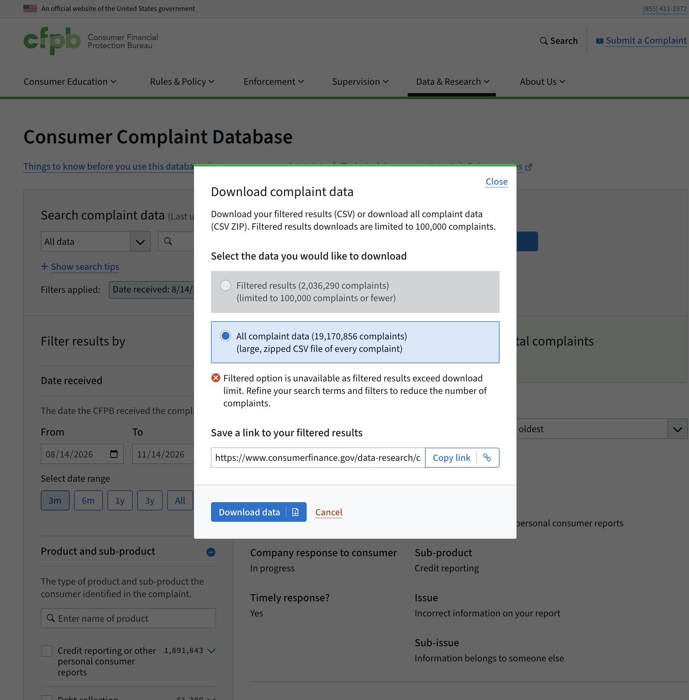

# Product features

Consumer Complaints platform, built hands-on and step by step. This file lists **what the product does**.
How it is built is in [ARCHITECTURE.md](../Middleware/ConsumerComplaintsHandsOn/ARCHITECTURE.md) and the
detailed decisions are in [DESIGN.md](../Middleware/ConsumerComplaintsHandsOn/DESIGN.md).

Status legend: **[Done]** exists in the repo, **[Planned]** decided but not built, **[Open]** not decided yet.

---

## 1. Purpose

Load the public CFPB Consumer Complaint Database into a local or cloud MongoDB through an admin portal, and later
build an intelligence app on top of it. Everything is run from the admin portal; the heavy work (download, ingest)
is done asynchronously by Apache Airflow.

## 2. Applications

| App | What it is | Status |
|---|---|---|
| `consumer-complaints-admin` | Angular admin portal under `Portals/consumer-complaints-admin/`. Imports datasets, ingests them into the database, shows status; syncs system secrets to Airflow. | Imports [Done]; Sync secrets UI [Done] (#153); AppEndpoints thin UI [Done] (#157); DB Ingest [Planned] (M04) |
| Middleware API | FastAPI service (`Middleware/ConsumerComplaintsHandsOn`). The only thing the portal talks to. | Core APIs [Done] (M02/M03); AppEndpoints list/read [Done] (#156); ingest/index APIs [Planned] (M04) |
| Apache Airflow | Runs the download and ingest (and later index) jobs asynchronously. | Local Docker [Done]; download/filter DAGs [Done]; ingest DAG [Done] (#158); index DAG [Planned] (M04) |
| `consumer-complaints-Intellect` | Intelligence app over local vectors (query MVP). | [Done] M05 (#152 / #166) |

## 3. The data

- **Source:** the CFPB Consumer Complaint Database, free to download from the government website.
  Field reference: <https://cfpb.github.io/api/ccdb/fields.html>.
- **Fields (15):** Date received, Product, Sub-product, Issue, Sub-issue, Company public response, Company, State,
  ZIP code, Tags, Submitted via, Date sent to company, Company response to consumer, Timely response?, Complaint ID.
- **No free-text complaint narrative.** The database is structured records only.
- **Size (as of 14 Nov 2026):** 19,170,856 complaints in total; 2,036,290 in the last 3 months (8/14/2026 to 11/14/2026).
  About 93% of the last 3 months is one product, "Credit reporting or other personal consumer reports".
- **Download limits found on the CFPB site** (see the screenshots in `docs/Design/`):
  - The filtered CSV download is **limited to 100,000 complaints**, so the 3-month window (2.0M) cannot be downloaded
    with a filter. The site disables that option.
  - The only complete download is **"All complaint data"**, one large zipped CSV (about 350 MB compressed).
  - In the part of that file I sampled, rows are **not sorted by date**, so a 3-month slice means reading the whole file
    and filtering by `Date received`.
- **The dataset is never committed to this repository.** It is fetched by a registered workflow (feature F3).

## 4. Features

### F1. Admin portal navigation [In progress]
- Top-level menu **DataSets** [Done] (#63, D69).
- Left navigation under it: **Imports** [Done] (#63); **DB Ingest** [Done] (#160).
- Imports shows one accordion per MIO with status from `GET /mios/status` [Done] (#64, D71); start + refresh [Done] (#65, D72); picker is per-MIO `allowed_workflows` excluding ingest/index (#141, D84, #160). DB Ingest mirrors Imports for `ingest_*` workflows (#160).
- Later: more datasets / MIOs are just more accordions / rows (for example "6 months").

### F2. Imports: bring the dataset in [In progress]
- Per accordion, show whether that MIO is ingested or not, when, and if it failed, why. Status comes from
  `GET /mios/status` (#45 / D61), not from guessing [Done] (#64, D71).
- A button starts the download [Done] (#65, D72 / #141, D84): picker options come from that MIO’s `allowed_workflows` on `GET /mios/status` (All → `download_cfpb_all`; 3 months → `filter_cfpb_3_months`; 6/9/12 unbound → empty / Start disabled). Starts with `mio_id` (`POST /workflows/{id}/start`; API rejects unbound), then refreshes status (manual Refresh; no polling). Start is also disabled while the ingest is `requested`/`started`. The real work runs in Airflow.
- **One API endpoint starts any registered workflow** (D46: there is no usecase).
- The **3 months** dataset is the **All** file filtered to the last 3 months, because the site cannot export 3 months.
- The same flow works locally (3 months, small) and in the cloud (All).

### F3. Registered workflows (no data in the repo) [Planned]
Each workflow that downloads or ingests data is registered in the database, so the portal can list it and start it.

| Registry column | Meaning |
|---|---|
| Workflow name | up to 100 characters, shown in the portal |
| Workflow engine type | Apache Airflow, AWS Step Functions, or another engine |
| Engine workflow id | the engine's own id: the Airflow DAG id, the Step Functions state machine |
| Config | JSON with anything about the workflow, so a definition is reusable |

- Every execution is recorded in an execution log with the same information.
- There can be several download workflows. Each knows its own source (local, GitHub, Drive, S3, Azure Blob, GCS, plain HTTP(S) and so on), so the API has no source-location types.
- Credentials never live in the repo.
- The registry and the catalog (datasets, dataset locations, MIOs, and their ingest log) live in the admin schema `consumer_comp_admin_db` (D48, D49). The RAG layer is a later milestone (D53).

### F4. System secrets sync (C) [Done — M04 #145]
- Fixed system names live in git-ignored `.env` (never in git, never shown in Admin UI).
- **Inventory (names only):**
  | Role | Names | Source of truth |
  |---|---|---|
  | Synced to Airflow Variables (D42) | `CCA_CALLBACK_SECRET`, `CCA_API_URL`, `CCA_DB_URL`, `CCA_MONGO_COMPLAINTS_URL`, `CCA_VECTOR_STORE_PATH`, `LOCAL_DATA_PATH_CFPB`, `CCA_CFPB_SPLIT_SOURCE_PATH` | `CICD/Local/airflow/Airflow_Variables_Upsert.txt` |
  | API-only (not upserted) | `CCA_AIRFLOW_API_BASE_URL`, `CCA_AIRFLOW_API_USERNAME`, `CCA_AIRFLOW_API_PASSWORD`, `CCA_OPERATIONAL_STORE`, `CCA_DATA_DIR`, `CCA_MONGO_OPERATIONAL_URL` | `.env.example` comments |
- Admin **Operations → Sync secrets** POSTs `POST /management/airflow/upsert-secrets` (#77 API, #153 UI). Outcomes only; values never rendered.
- Local only until M06.

### F5. AppEndpoints (D) [Done — M04 #146]
- Categorized endpoints (source / ingest / index / db) with from/to refs to locations and env-var *names* (D85).
- Schema + DAO + CFPB source seed: #155. List/read API #156; thin Admin UI on Imports #157.
- Imports (then ingest/index) use AppEndpoints. Local/HTTP first; no cloud spend.

### F6. DB Ingest: load complaints into MongoDB (A) [Done — M04 #147; split parts M06 #169]
- Airflow ingest DAG `ingest_cfpb_all` writes **local Mongo** complaint docs in batches (upsert by Complaint ID) via `CCA_MONGO_COMPLAINTS_URL` (D86 / #158).
- **Split parts (D91 / M06):** stage `complaints_part_*.csv.zip` from `CCA_CFPB_SPLIT_SOURCE_PATH` into `LOCAL_DATA_PATH_CFPB` (`cfpb_stage_split_to_local`), then ingest loops the glob (#172–#174).
- **DB Ingest** Admin screen mirrors Imports; only after download completed for that MIO (#160).
- API never bulk-writes complaint documents.
- Stories: #158 DAG+callbacks, #159 register/bind, #160 Admin screen; M06 #172/#173/#174.
- Plain Python batches first; PySpark only if measured. **[Open]**

### F7. Dataset locations expansion (B) [Done — M04 #148]
- DAGs resolve from/to via AppEndpoints when `app_endpoint_name` is set (D87 / #161); locations remain single path/env rows.
- Admin Imports panel clarifies location vs AppEndpoint; secrets never shown (#162).
- Cloud location types stub-only until local is hard (M06 later).

### F8. Local vector indexing (E) [Done — M04 #149; pluggable Storage Layer M07 #175]
- Index local Mongo complaints into a **local** filesystem vector store (`CCA_VECTOR_STORE_PATH`, JSONL + hash embeddings MVP, D88).
- Airflow `index_cfpb_all` + AppEndpoint `cfpb_index_mongo_to_vectors`; Admin **Index** screen (`index_*`) after ingest completed (#163/#164).
- **Pluggable Storage Layer (D92 / M07, extended D94 / M09):** `open_vector_store` backends `jsonl`|`pgvector`|`chroma`|`redis`; pgvector on ops Postgres; Chroma + Redis Stack as separate containers; distinct AppEndpoints `_pgvector` / `_chroma` / `_redis` (#179–#182, #200–#205).
- Cloud vector SaaS out of scope (M90). Retrieval ladder = M08.

### F9. Status tracking and history [Done for download; extends with ingest/index]
- `app_workflows_exec_log` + `mios_ingest_log` (D50); Airflow reports via API callbacks only.

### F10. Two environments, one codebase [Planned]
- **Local first — 100% until hardened** (M04/M05). **Cloud** in M06 after local DoD. Config, not code forks.

### F11. Data stores [In progress]
- **MongoDB (complaints):** local container [Done]; bulk load [Planned] M04.
- **Operational store:** SQLite default; Postgres/Mongo via `.env` [Done] M03. Will hold AppEndpoints (M04).

### F12. Database schema versioning [Done locally; cloud workflow deferred to M06]
- Alembic migrations create and evolve the operational database (Mongo ops profile uses bootstrap).
- Locally, the start script migrates/bootstraps, then starts the API.
- Cloud migrations: M06 (#24).

### F13. API contract [Done for current surface]
- Committed OpenAPI (`openapi.json`) checked in CI; regenerate when models change.

### F14. Developer experience [Done]
- Profiled local containers + portals npm scripts; `uv` for Middleware; Node 22+ for Admin.

### F15. MIO ACL (F) [Done — M05 #151]
- Who may start which MIO (`internal` / `partner` / `user`) via `mios_acl` (D89). Enforce on start-workflow with `X-CCA-Audience`. Story #165.

### F16. Intelligence app (G) [Done — M05 #152]
- `consumer-complaints-intellect`: query local vector store (`POST /intellect/query`, D90). Not Admin Imports. Story #166.
- **Retrieval ladder (D93 / M08):** optional `config` (`baseline`…`everything`); hybrid BM25+RRF; local stubs for self-query/decompose; lexical rerank; golden EVALUATION scorecard (ship bias: `reranker`). Stories #187–#189.
- Early RAG draft on `backups/Cursor_Initial_Impl` is reference only; no paid LLM in MVP.

## 5. Delivery status

| Item | Status |
|---|---|
| M01 foundation / M02 downloads / M03 Admin E2E | Done |
| Upsert secrets API (D42) + Admin Sync UI | Done (#77, #153); inventory docs #154 |
| AppEndpoints / DB Ingest / locations harden / local vectors | Done M04 (#144) |
| MIO ACL + Intellect | Done M05 (#150) |
| Split CFPB landing + SoT batch ingest | Done M06 (#169 / #172–#174) |
| Pluggable local vector Storage Layer (pgvector) | Done M07 (#175 / #179–#182) |
| Advanced Intellect retrieval + EVALUATION ladder | Done M08 (#183 / #187–#189) |
| Extra local vector backends (Chroma, Redis) + pgvector consolidate | Done M09 (#195 / #200–#205) |
| Intellect Query AST over curated | Done M52 (#351 / #352–#354) |
| Internal Systemic Risk Radar MVP | Done M53 (#358 / #359–#361) |
| Query AST zero-hit relaxation | Done M54 (#365 / #366–#368) |
| Lakehouse Spark PATH + sequenced hydrate dropdown + lift Variable | Done M55 (#371 / #372 / #374) |
| Cloud deployment | Planned M90 (#73; was M06) |

## 6. Milestones

| Milestone | Focus | Status |
|---|---|---|
| M01–M03 | Foundation, downloads, Admin E2E | Complete |
| **M04** | Local ops hardening: **C→D→A→B→E** (#144) | Done |
| **M05** | Intellect + MIO ACL: **F→G** (#150) | Done |
| **M06** | Split CFPB landing + complaint SoT batches (#169) | Done |
| **M07** | Pluggable local vector Storage Layer (#175) | Done |
| **M08** | Advanced Intellect retrieval + evaluation (#183) | Done |
| **M09** | Chroma + Redis Stack (separate containers) + consolidate pgvector (#195) | Done |
| **M45–M50** | Iceberg lakehouse spine (Raw→…→Query AST) — npm/prove + Raw DAG | Done |
| **M51** | Admin Lakehouse workflows (UI→Middleware→Airflow→status) (#340 / #341–#345/#349) | Done |
| **M52** | Intellect Query AST over curated lakehouse (#351 / #352–#354) | Done |
| **M53** | Internal Systemic Risk Radar MVP (#358 / #359–#361) | Done |
| **M54** | Query AST zero-hit relaxation (#365 / #366–#368) | Done |
| **M55** | Lakehouse Spark PATH + sequenced dropdown + hydrate lift Variable (#371 / #372 / #374) | Done |
| **M90** | Cloud deployment (parked; was M06) (#73) | Planned |

## 7. Open questions

1. ~~AppEndpoints exact columns / categories~~ — closed by D85 / #155 (`source`\|`ingest`\|`index`\|`db`).
2. ~~Complaint Mongo connection string naming for DAGs~~ — closed by D86 (`CCA_MONGO_COMPLAINTS_URL`).
3. ~~Vector store choice for local MVP~~ — closed by D88 (filesystem JSONL under `CCA_VECTOR_STORE_PATH`; hash embeddings for CI).
4. ~~Does Intellect share the operational database?~~ — closed by D90 (no; filesystem vectors only for MVP).
5. What does "Airflow" mean in the portal chrome (link vs screen)? (still open)
